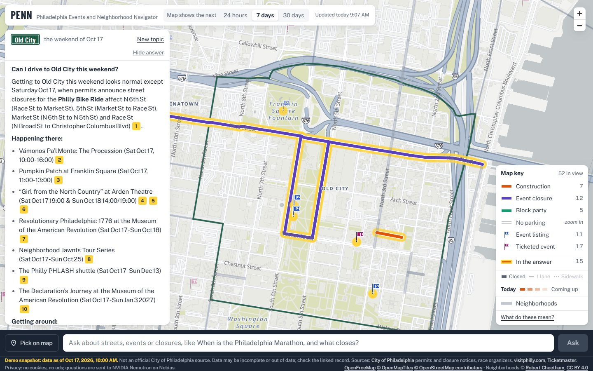
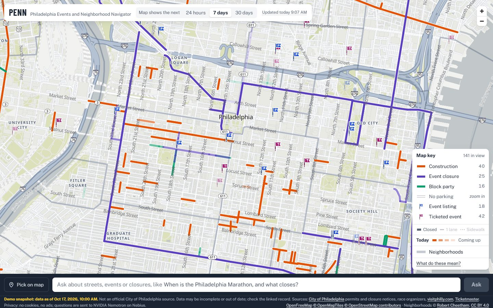
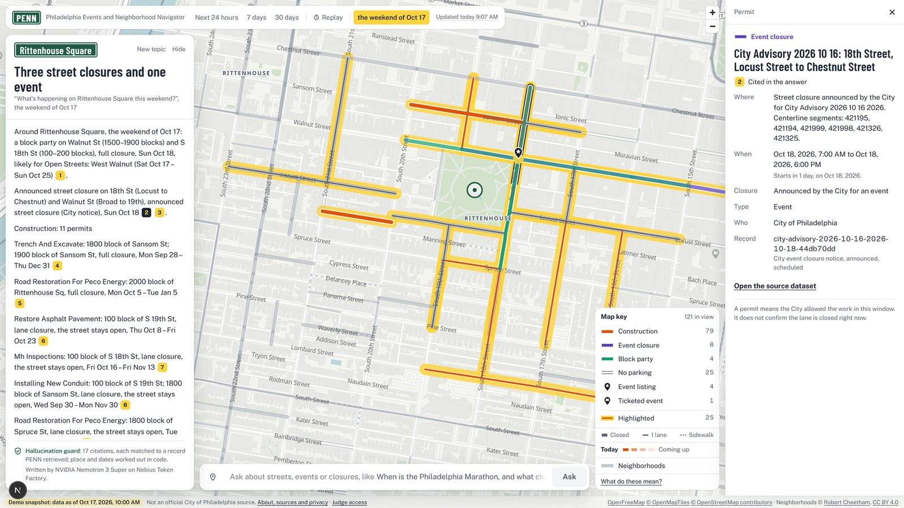
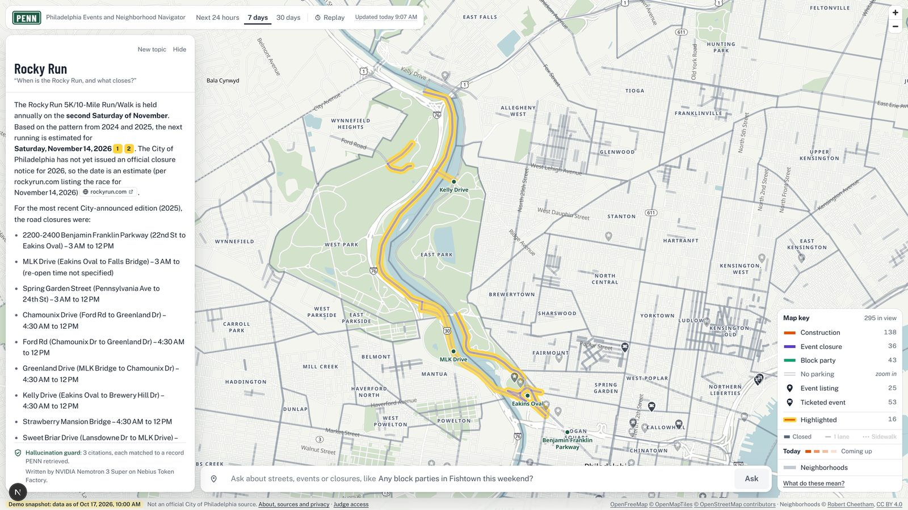
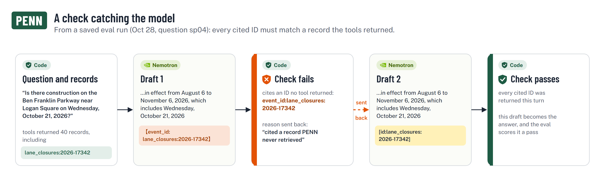
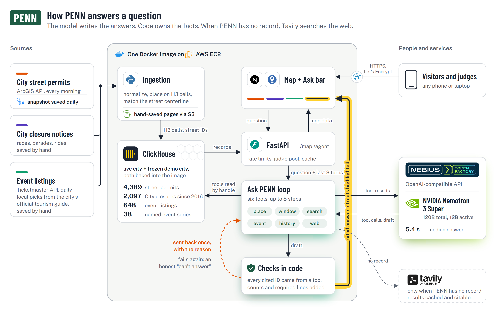
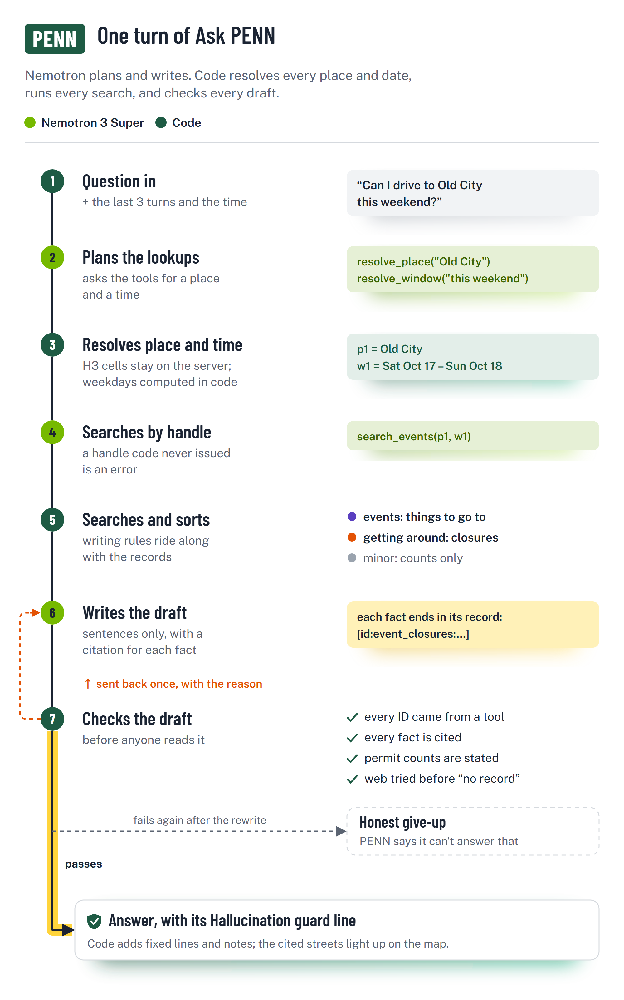

<div align="center">


# PENN

### Philadelphia Events and Neighborhood Navigator

**Ask *"Can I drive to Old City this weekend?"* and get a short trip brief with a source for every fact.**

[](https://3-211-230-213.sslip.io)


[](LICENSE)


</div>

> **Judges:** open the live demo, choose **I am a Judge**, and enter the access code from our submission.
> That gives you your own question allowance. To run PENN on your machine, jump to
> **[Run it locally](#run-it-locally)**.

<p align="center">
  
</p>

**The model writes the answers. Code owns the facts.** PENN puts every Philadelphia street permit, City
closure notice and event listing on one map. Its agent, **Ask PENN**, runs on **NVIDIA Nemotron 3 Super**
through **Nebius Token Factory**. Code works out every place, date, weekday, count and citation, and
checks each draft before you see it.

---

## Contents

| | |
|---|---|
| [The problem and the map](#the-problem-and-the-map) | [How NVIDIA Nemotron and Nebius are used](#how-nvidia-nemotron-and-nebius-are-used) |
| [What an answer looks like](#what-an-answer-looks-like) | [Choosing the model](#choosing-the-model) |
| [Try it: a demo script](#try-it-a-demo-script) | [Evaluation](#evaluation) |
| [Architecture](#architecture) | [Run it locally](#run-it-locally) |
| [Production deployment](#production-deployment) | [Data and licenses](#data-and-licenses) |
| [Known limits and what's next](#known-limits-and-whats-next) | [Repository layout](#repository-layout) |

---

## The problem and the map

Whether a Philly street is open depends on four sources that never talk to each other:

| Source | What it tells you | What it doesn't |
|---|---|---|
| City street-permit layer | Which blocks have a permit, and the dates | Hours, and anything once the permit expires |
| City closure notices | Race, parade and ride closures | Only in press releases, one at a time |
| Ticketmaster and the local picks from the city's official tourism guide | What's happening, and where | Anything about the streets around it |

None of them answers *"can I get there on Sunday?"* PENN puts all of them on one map, and the map
answers *"why is this street affected?"* before you ask anything:

<table>
<tr>
<td width="55%"></td>
<td>

**Color is the reason**

 **Construction**: road, utility and building work<br>
 **Event closure**: announced by the City (races, parades)<br>
 **Block party**: the block is closed for the party<br>
 **Cited in the answer**: lit up while an answer is open

**Line weight is the extent**

 thick: the street is closed<br>
 thin: one lane<br>
 dots: sidewalk work

**Fading is time.** Solid lines are today; fainter lines are coming up.

**Flags are things to go to.** An event listed in two places gets one flag.

</td>
</tr>
</table>

---

## What an answer looks like

Someone deciding whether to drive somewhere cares about a handful of things, so every answer has the same
shape. The details stay on the map.

| Part | Example from *"Can I drive to Old City this weekend?"* |
|---|---|
| **The opening line** | Getting there is normal, except for one thing: the Philly Bike Ride. |
| **Happening there** | Concerts, games, festivals and listings, with times |
| **Getting around** |  The ride's closures, folded into one line from one City notice |
| **Everything minor, as a count** | "Plus *n* smaller permits (lane work, loading zones, sidewalk work) are on the map." |
| **Citations** | Every fact has a numbered chip. Click it and that exact record opens. |
| **Hallucination guard** | How many citations were matched to records PENN retrieved, that the place and dates were worked out in code, and any draft that was sent back, with the reason |

<table>
<tr>
<td width="50%"><br><sub><b>Click a citation, see the record.</b> Rittenhouse Square this weekend: citation 2 opens the City's closure notice. 17 citations, each matched to a record PENN retrieved.</sub></td>
<td width="50%"><br><sub><b>Ask by event, not by place.</b> "When is the Rocky Run?" PENN reads the 2024 and 2025 notices, predicts Saturday, Nov 14, 2026, and draws the route up Kelly Drive.</sub></td>
</tr>
</table>

---

## Try it: a demo script

| Ask | What it shows |
|---|---|
| *Can I drive to Old City this weekend?* | The trip brief. Code decides what counts as "getting around" and what is only a count. |
| *When is the Rocky Run, and what closes?* | An event by name, with **no place given**. Code reads every past edition and infers "second Saturday of November". |
| *Does the Mummers Parade close Broad Street every year?* | History across years. PENN names the years it has records for, and says it can't vouch for the others. |
| *Spruce and 15th next week* | A typed intersection, resolved offline on the City's street centerline. |
| *What about the week after?* | A follow-up. The place carries over; only the time window changes. |
| *Any concerts in Old City tonight?* | Listings, with duplicates matched across Ticketmaster and the local picks. |
| *Is Camden closed tomorrow?* | Out of scope. PENN covers Philadelphia only, and says so. |

---

## How NVIDIA Nemotron and Nebius are used

### NVIDIA Nemotron 3 Super answers every question

| What Nemotron does | What code does instead |
|---|---|
| Plans the turn with **six tools** (function calling) | Resolves places and dates and runs every search |
| Gets back short handles: `p1` for "Old City", `w1` for "this weekend" | Keeps the hundreds of H3 cells and the computed weekdays on the server. A handle no tool issued is an error, so **the model can't invent a place or a date.** |
| Writes the trip brief, citing `[id:…]` for every fact | Checks every cited ID against what the tools returned **that turn**, and sends a bad draft back once, with the reason |
| Rewrites once if a check fails | Adds the sentences that must always appear ("permits list dates, not hours"). If the rewrite fails too, PENN says honestly that it can't answer. |

Super has habits, and code handles them. It often writes `【id:…】` instead of `[id:…]`: only 52% of its
citations came back in the requested format at first. A lenient parser reads its variants (and still
rejects `[1]`), and the checks catch the rest. The code is in
[`agent/loop.py`](backend/penn/agent/loop.py), [`agent/context.py`](backend/penn/agent/context.py) and
[`agent/citations.py`](backend/penn/agent/citations.py).

### Nebius

**Token Factory is how PENN reaches Nemotron.** Every Ask PENN answer, and every eval run, is a request
to Token Factory's OpenAI-compatible API for `nvidia/nemotron-3-super-120b-a12b`, sent with the stock
`openai` Python client.

**Where it sped up our work:** Token Factory serves many models behind the same API, so trying a different
model meant changing one string. That's how we ran Nemotron 3.5 Lightning, Super and Ultra on the same
questions before choosing Super ([Choosing the model](#choosing-the-model)).

**Tavily** (by Nebius) is the web search PENN falls back on when its own records have nothing.

**Hosting is not on Nebius.** We requested Nebius AI Cloud CPU (non-GPU vCPU) quota to run the app's
container. It wasn't granted, and Nebius support suggested using other available resources, so the app
runs on AWS EC2.

---

## Choosing the model

We chose with five questions, in this order:

1. **Is it open?** PENN is built on NVIDIA's open Nemotron models.
2. **Is it fast enough?** People ask PENN on their way out the door.
3. **Does it get the facts right?**
4. **Does it follow the citation and wording rules?**
5. **What does a question cost?**

### Within the Nemotron family

On Oct 28 we ran all three sizes on the current agent, on the frozen city, through Token Factory.
"Passed" counts the 52 questions outside trip briefs (see the note below).

| | Nemotron 3.5 Lightning<br><sub>3B active / 30B</sub> | **Nemotron 3 Super** (PENN's model)<br><sub>12B active / 120B</sub> | Nemotron 3 Ultra<br><sub>55B active / 550B</sub> |
|---|---|---|---|
| Runs | 1 | 4 | 4 |
| **Passed, of 52** | 22 (42%) | **41.0 (79%)**, range 40–42 | 38.25 (74%), range 38–39 |
| Lookups, specific, multi-day, place | 67% | 85% | **92%** |
| Negatives ("no record" is right) | 33% | **100%** | 62% |
| Street history | **75%** | 66% | 66% |
| Traps | 17% | **74%** | 67% |
| Gave up honestly ("can't answer") | 34% | **under 1%** | 4% |
| p50 / p90 answer time | 10.9 s / 26.7 s | **7.6 s / 16.4 s** | 8.0 s / 18.5 s |
| Output tokens per answer | 962 | 1,062 | 2,333 |
| Prompt tokens per answer | 148k | 21k | **20k** |
| Model calls per answer | 5.3 | 2.8 | **2.4** |
| Citations in the requested format | 97% | 79% (99% after parsing) | **99%** |
| **Verdict** | Gives up on a third of questions, at 7× the prompt tokens | **Ships: most accurate and fastest of the three** | Better at plain lookups, but often answers where "no record" is right |

**Ultra used to win; on the fixed agent it doesn't.** Before our fixes, Ultra passed more (30.25 against
25.0 of 51 questions, four runs each), but its p90 was 33.4 s. On the fixed agent, Super passes more than
Ultra, answers faster, and writes less than half the tokens. Its one weak spot is the citation format,
which the parser absorbs.

> **Note on trip briefs.** The answer key for the 6 trip-brief questions still expects the minor-permit
> counts from Oct 18 ("Plus 74 smaller permits"). On Oct 21 we changed how minor permits are counted
> (weeks-long lane work folds into one line, and work just outside a neighborhood is counted, not
> briefed), so today's tools report "Plus 49". Every model now gives the new number and fails that one
> fact, so trip briefs are left out of the comparison until the key is updated.

### Against same-size models from other labs

An earlier comparison: Oct 18–19, all 57 questions then in the set, one run each, on the agent as it was
before the fixes above:

| Model | Active / total | Passed | p50 / p90 | Citations in requested format | Drafts sent back |
|---|---|---|---|---|---|
| **NVIDIA Nemotron 3 Super** | 12B / 120B | 42/57 | 5.4 s / 8.2 s | 78% (100% after parsing) | 21% |
| DeepSeek-V4-Flash-0731 | 13B / 284B | 55/57 | 3.5 s / 8.3 s | 100% | 4% |
| Qwen3.5-397B-A17B | 17B / 397B | 47/57 | 9.9 s / 17.1 s | 100% | 5% |

**How we read it.** DeepSeek-V4-Flash scores higher, and we say so. Breaking the results down by category
shows where the gap is:

| Category | Nemotron Super | DeepSeek-V4-Flash | Qwen3.5 |
|---|---|---|---|
| Lookups, negatives, specific, multi-day | 19/20 | 20/20 | 17/20 |
| Street history | 6/8 | 7/8 | 6/8 |
| Trip briefs | 5/6 | 6/6 | 6/6 |
| Trap-tagged questions | 12/23 | 22/23 | 18/23 |

Even then, Super was as good as its peers at the job itself, finding the right records. Its gap was
almost entirely in *traps*, where the answer hinges on exact wording ("a permit is in effect", never "the
street is closed"). Those rules can be fixed one at a time. On a hard 12-question subset, prompt fixes took
Super from 6/12 to 10/12, and moving the last two rules into code took it to 12/12. Across the four Oct 28
runs, Super passes 74% of trap questions, up from 52% (12/23) in this run. So we ship the open NVIDIA
model, and keep closing the trap gap in code.

---

## Evaluation

**Scored by code, not by another LLM.** 58 questions run on a frozen copy of the city (Saturday,
Oct 17, 2026, 10:00 a.m.), so an answer never fails just because a permit was filed later.

| Question type | Count | A real question from the set |
|---|---|---|
| Lookups, specific, multi-day, place | 16 | *What street permits are in effect on the blocks at 13th and Locust on Saturday, October 10, 2026?* |
| Negatives ("no record" is right) | 7 | *Is there a block party near 13th and Locust on Saturday, October 10, 2026?* |
| Street history | 8 | *Was Broad Street closed at Snyder Avenue for the Broad Street Run this year?* |
| Traps | 21 | *Is Spruce Street closed to cars at 1327 Spruce Street on Saturday, October 10, 2026?* A permit is in effect; that is not proof the street is closed. |
| Trip briefs | 6 | *Rittenhouse next week* |

The results tables count traps by tag, which gives 23: two non-trap questions also carry a trap tag.

A question passes only if **all four** hold:

1. The right tools were called.
2. Every required fact appears.
3. Every cited ID was really returned by a tool.
4. No forbidden claim appears.



**A check catching the model, from a saved run.** Question sp04 asks *"Is there construction on the Ben
Franklin Parkway near Logan Square on Wednesday, October 21, 2026?"* Super's first draft had the right
permit but cited it as `【event_id:lane_closures:2026-17342】`, an ID no tool returned. Code sent it back
with the reason, "cited a record PENN never retrieved". The rewrite cited `[id:lane_closures:2026-17342]`,
and the eval scored it a pass. Across the Oct 28 runs, about **a quarter of Super's answers** were sent
back like this, each by a check in code, before anyone would have read them.

**Re-check our scores with no API key and no database.** Every saved answer keeps its full trace: tool
calls, returned IDs, every draft, latency and tokens. After [steps 1 and 3](#run-it-locally):

```bash
cd backend
# The Nemotron family on the current agent (Oct 25-28): Lightning, Super and Ultra
python -m penn.eval --leaderboard ../eval/results/*.json
# The earlier comparison with other labs' models (Oct 18-19)
python -m penn.eval --leaderboard \
  ../eval/baselines/super-penn_demo-2026-10-18-fixes.json \
  ../eval/baselines/deepseek-v4-flash-penn_demo-2026-10-19.json \
  ../eval/baselines/qwen3.5-397b-penn_demo-2026-10-19.json
```

Each prints its comparison table above. **Unit tests:** run `cd backend && python -m pytest -q`; 291 tests
cover place resolution, intersections, time windows, impact tiers, citation parsing, the agent loop with
a fake model, and every ingestion parser.

---

## Architecture



| Layer | Technology |
|---|---|
| Model | NVIDIA Nemotron 3 Super via Nebius Token Factory (OpenAI-compatible API) |
| Agent and API | Python 3.11+, FastAPI, Uvicorn, `openai` client, Pydantic |
| Database | ClickHouse 26.9 (ReplacingMergeTree, H3 bloom-filter index) |
| Geo | Uber H3 at resolution 9, the City's street centerline, 112 landmarks, neighborhood outlines |
| Frontend | Next.js 16, React 19, MapLibre GL 6, OpenFreeMap tiles |
| Web fallback | Tavily search, cached |
| Deployment | One Docker image on AWS EC2, Caddy and Let's Encrypt, S3 for hand-saved weekly data |

<details>
<summary><b>One turn, step by step</b> (diagram and the six tools)</summary>

<br>

<p align="center">
  
</p>

| Tool | Returns |
|---|---|
| `resolve_place` | A handle for a neighborhood, a corner ("12th and Walnut"), an address, or one of 112 landmarks |
| `resolve_window` | A handle and label for "this weekend", "next Tuesday", "Nov 14" |
| `search_events` | The records for a place and window, sorted into *events*, *getting around* and *minor* (counts only) |
| `find_event` | An event by name, city-wide: past editions, the predicted next date, a route summary |
| `get_location_history` | Every year PENN has records for at that place |
| `search_web` | Tavily results, each one a citable `web:` record |

The writing rules for permits, events or web pages arrive with the first tool result of that kind, not in
the system prompt. That halved the prompt at no measured cost.

</details>

<details>
<summary><b>Design decisions</b> (why it's built this way)</summary>

<br>

- **Handles, not coordinates.** A neighborhood is hundreds of H3 cells, too many for the model to copy
  between calls, and the model got weekdays wrong. Handles with labels that code computed fixed both.
- **Guarantees go in code, because prompt rules leak.** Asking the model to flag ambiguous questions
  worked on 0 of 3 eval questions. Now: *if a sentence must always appear, code adds it*
  ([`ambiguity.py`](backend/penn/agent/ambiguity.py)).
- **Trip briefs, not permit lists.** "Rittenhouse next week" once produced 89 accurate, unusable
  bullets. [`impact.py`](backend/penn/agent/impact.py) keeps what changes the drive and counts the rest.
- **The question decides the tools.** A tester asked *"When is the Rocky Run?"* and PENN asked for a pin.
  The answer was already in our City notices, so we built [`events.py`](backend/penn/agent/events.py).
- **One model, no routing.** We built a Nano/Super/Ultra router, measured it, and removed it.
- **Neighborhoods keep to their outline.** User testing found a "Fairmount" search listing work in
  Francisville, one block over. Now a neighborhood question briefs only streets inside the real outline;
  work just outside is counted, not briefed.
- **Freeze the city.** A pinned clock and a frozen database make every demo and eval run comparable.
- **Color means reason.** People ask *why* a street is affected, so three hue families mean three reasons,
  and yellow is kept for the answer.
- **No scraping.** The local picks and the City's closure notices are saved by hand in a browser and parsed
  offline. Anything the parser can't read is logged, never guessed. Tavily gets a short search query,
  never the user's message.

</details>

---

## Run it locally

You run the full app on a **sample city**: the frozen demo morning, cut to Greater Center City. No API key
is needed except for Ask PENN.

| | Live demo | Local sample city |
|---|---|---|
| Area | All of Philadelphia | Greater Center City (river to river, Fairmount to Passyunk Square) |
|  Street permits | 4,389 | 1,483 |
|  City closures on the map | 1,481 | 1,239 |
| Event listings | 648 real | **30 made up** (15 ticketed, 15 local picks) at real venues, labeled *"(sample data)"* |
| Clock | Live, plus the frozen Oct 17 view | Frozen: Saturday, Oct 17, 2026, 10:00 a.m. |
| Ask PENN | Yes | Yes, with your Token Factory key |

### Prerequisites

Git · Docker (running) · Python 3.11+ · Node.js 20.9+ · a POSIX shell (macOS/Linux, WSL, or Git Bash on
Windows) · optionally a [Nebius Token Factory](https://tokenfactory.nebius.com) key for Ask PENN.
Ports used: **8123** ClickHouse, **8000** API, **3000** map.

### Quickstart

```bash
# 1. Clone and download the sample city (about 5 MB)
git clone https://github.com/changhyeonlim/PENN.git && cd PENN
curl -L -o penn-sample-city.tar.gz https://github.com/changhyeonlim/PENN/releases/download/sample-city-v1/penn-sample-city.tar.gz
tar -xzf penn-sample-city.tar.gz

# 2. Start ClickHouse and load the sample city
docker run -d --name penn-ch -p 8123:8123 -e CLICKHOUSE_SKIP_USER_SETUP=1 \
  --ulimit nofile=262144:262144 clickhouse/clickhouse-server:26.9.23.15
until docker exec penn-ch clickhouse-client -q "SELECT 1" >/dev/null 2>&1; do sleep 1; done
sh deploy/restore_db.sh penn_sample

# 3. Install the backend, point it at the sample city, run the tests
python3 -m venv .venv && source .venv/bin/activate     # Windows Git Bash: source .venv/Scripts/activate
pip install -e "backend[dev]"
cp .env.example .env
printf 'CLICKHOUSE_DB=penn_sample\nPENN_NOW=2026-10-17T10:00:00-04:00\n' >> .env
# Optional, for Ask PENN: put your key on the TOKEN_FACTORY_API_KEY= line in .env
(cd backend && python -m pytest -q)

# 4. Start the API (leave it running)
uvicorn penn.api:app --app-dir backend --port 8000

# 5. In a new terminal: start the map (leave it running), then open http://localhost:3000
cd frontend && npm ci
echo "NEXT_PUBLIC_PENN_NOW=2026-10-17T10:00:00-04:00" > .env.local
npm run dev
```

### How you know it worked

| After step | You should see |
|---|---|
| 2 | `penn_sample.events: 2752 rows` (and five more tables) |
| 3 | `291 passed, 1 skipped` |
| 4 | `curl -s localhost:8000/health` prints `{"ok":true}` |
| 4 | `curl -s localhost:8000/map \| python3 -c "import json,sys; print(len(json.load(sys.stdin)['events']))"` prints `745` |
| 5 | <http://localhost:3000>: choose **I am a Visitor**. Center City for the week of Oct 17, with construction, event and block-party streets and event flags. |

**Then try it:**
- Click a colored street to open its record.
- Switch between 24 hours, 7 days and 30 days.
- Ask *"Any concerts in Old City tonight?"* The answer finds *The Delancey Strings: Autumn Folk Night*, a
  made-up listing on both sources that the map shows as one flag.

Without a key, Ask PENN replies that it's unavailable, and the map keeps working. If you set a key after
starting the API, restart it. Clean up with `docker rm -f penn-ch`.

<details>
<summary><b>Notes for AI coding agents</b></summary>

<br>

- Run the quickstart from the repo root, in order. The table above is the success check for each step.
- Keep the API (step 4) and the map (step 5) running as separate background processes.
- Never print or commit `.env`.
- If port **8123** is taken, map ClickHouse to another host port (`-p 18123:8123`) and add
  `CLICKHOUSE_PORT=18123` to `.env`.
- If port **8000** is taken, start the API on another port and add
  `NEXT_PUBLIC_PENN_API=http://localhost:<port>` to `frontend/.env.local`.
- If port **3000** is taken, set `PENN_CORS_ORIGINS=http://localhost:<port>` when starting the API.
- Ask PENN from the command line:
  `curl -s -X POST localhost:8000/agent -H 'content-type: application/json' -d '{"question":"Any concerts in Old City tonight?"}'`.
  The answer text is in the `answer` field.

</details>

<details>
<summary><b>Configuration reference</b> (<code>.env</code> and <code>frontend/.env.local</code>)</summary>

<br>

| Variable | Needed for | Default |
|---|---|---|
| `CLICKHOUSE_HOST`, `CLICKHOUSE_PORT`, `CLICKHOUSE_USER`, `CLICKHOUSE_PASSWORD` | everything | `localhost`, `8123`, `default`, empty |
| `CLICKHOUSE_DB` | everything | `penn`; use `penn_sample` for the sample city |
| `PENN_NOW` | a frozen city: pins "now" so answers don't drift | empty (real clock) |
| `TOKEN_FACTORY_API_KEY` | Ask PENN | empty (Ask PENN unavailable) |
| `TOKEN_FACTORY_BASE_URL` | Ask PENN | `https://api.tokenfactory.us-central1.nebius.com/v1/` |
| `MODEL_SUPER` / `MODEL_CHAT` | the model; `MODEL_CHAT` overrides it to compare models | `nvidia/nemotron-3-super-120b-a12b` / empty |
| `TAVILY_API_KEY` | web search when PENN has no record (live clock only) | empty (off) |
| `TICKETMASTER_API_KEY` | the `ticketmaster` load job | empty |
| `PENN_CORS_ORIGINS` | the map's origin, if not `http://localhost:3000` | `http://localhost:3000` |
| `PENN_PUBLIC`, `PENN_JUDGE_CODE` | the public deployment's rate limits and judge gate | off |
| `NEXT_PUBLIC_PENN_API` (frontend) | where the map finds the API | `http://localhost:8000` |
| `NEXT_PUBLIC_PENN_NOW` (frontend) | must match `PENN_NOW` | empty |

</details>

---

## Production deployment

The live demo is **one Docker image** ([`deploy/endpoint.Dockerfile`](deploy/endpoint.Dockerfile)):

| Inside the image | What it does |
|---|---|
| ClickHouse | The live city and the frozen demo city, both loaded at build time, so the container starts in seconds |
| Two FastAPI processes | One for the live city, one for the frozen Oct 17 city, both on `127.0.0.1` |
| Next.js | The only exposed port (3000). It forwards `/api/live/*` and `/api/demo/*` to the APIs. |
| Daily refresh | Reloads City permits and Ticketmaster each morning, and pulls the weekly hand-saved local picks and City notices from S3 ([`refresh.sh`](deploy/endpoint/refresh.sh), [`data_bucket.py`](deploy/data_bucket.py)) |
| Guardrails | Per-visitor rate limits, a judge pool with its own allowance, an answer cache, and per-question token and time ceilings ([`guardrails.py`](backend/penn/guardrails.py)) |

It runs on an AWS EC2 `m7i-flex.large` (us-east-1), with the image in Amazon ECR and HTTPS through Caddy
and Let's Encrypt. Inference is on Nebius Token Factory. To build it, run
`sh deploy/release.sh [--ref <git ref>] [--push]`: it takes the code from a git ref and exports the data
from the builder's local ClickHouse.

---

## Data and licenses

| Source | Live demo | Local sample | How it arrives | License / terms |
|---|---|---|---|---|
|  City Street Lane Closures (ArcGIS) | 4,389 permits | 1,483 | Daily API load | City of Philadelphia open data |
|  City Office of Special Events notices | 2,097 closures (2016–2026), 1,481 on the map | 1,843, 1,239 on the map | Saved by hand from phila.gov, parsed, matched to the centerline | City of Philadelphia public notices |
| Ticketmaster Discovery API | 610 events | 15 made up | Daily API load | Ticketmaster terms; not redistributed |
| visitphilly.com weekly picks | 38 events | 15 made up | Saved by hand weekly, parsed offline | visitphilly.com terms; not redistributed |
| Named event series | 38, with aliases | same | Curated; a source URL for every edition | this project |
| Places | Neighborhoods, 112 landmarks, street centerline | same | City open data | City open data; neighborhood outlines © Robert Cheetham, CC BY 4.0 |

[`deploy/make_sample.sh`](deploy/make_sample.sh) builds the sample archive from a local copy of the full
frozen city. Every record is placed on H3 resolution-9 cells (about a block group) and matched to the
City's street segment IDs, so a search at a corner catches the right blocks.

---

## Known limits and what's next

| Limit | What we're doing about it |
|---|---|
| **Permits list dates, not hours**, and PENN can't see whether a street is *actually* closed | Every answer says so; code adds the line |
| **Traps are still the hardest category:** Super passes 74% of them (up from 52%), against 85–100% elsewhere | Move each wording rule from the prompt into code, as with the 6/12 → 12/12 subset |
| **Street history is the next weakest** (66% for both Super and Ultra) | The next category to work through, after traps |
| **The trip-brief answer key is out of date:** it expects the minor-permit counts from before the Oct 21 counting change, so every model fails that one fact | Update the six expected counts, then put trip briefs back in the comparison |
| **The local picks and City closure notices are saved by hand each week**, so they can lag by days | We've asked the City's Office of Innovation & Technology and the guide's publisher about official feeds |
| **Super's p90 varies from day to day** on the shared endpoint: 8.2 s on Oct 18, 16.4 s on Oct 28 | Per-question time ceilings on the live demo; the answer cache serves repeat questions instantly |
| **One container on one VM** (AWS EC2) | It refreshes daily, and the image is plain Docker, so it can run on any host |
| **The local sample city** covers Center City only, with made-up listings. Web search is off there, because the pinned clock reads only a search cache that isn't shipped. Re-running models on the eval needs the full frozen city, which isn't published. | Use the live demo for the whole city; re-score saved runs locally |
| **Not an official City of Philadelphia source** | The footer of every screen says so |

**Next:** alerts ("tell me if anything closes near my block this weekend"), and more cities. Nothing in
PENN is Philadelphia-specific except its sources.

---

## Repository layout

```
backend/penn/
  agent/loop.py        Ask PENN loop: Nemotron call, tools, checks, one rewrite, honest give-up
  agent/context.py     the six tools; places and windows as handles
  agent/impact.py      trip-brief tiers: events / getting around / minor counts
  agent/events.py      events by name: past editions, next-date rule, route summary
  agent/citations.py   citation parsing and checking
  agent/ambiguity.py   fixed ambiguity notes, added in code
  geo/                 H3 cells, street centerline, intersections, landmarks, place lookup
  ingestion/           City permits, City notices, Ticketmaster, local picks, curated events
  eval/                eval runner, code scorers, leaderboard
  guardrails.py        public-demo rate limits, judge pool, answer cache, spend ceilings
  api.py               FastAPI: /map, /events, /locate, /freshness, /agent, /judge
backend/tests/         291 unit tests
frontend/              Next.js + MapLibre: map, key, record panel, Ask bar, cited-answer view
database/schema.sql    ClickHouse schema
jobs/run_job.py        data loads (daily and by hand)
eval/*.py              eval question tools (freeze records, validate questions)
deploy/                Docker image, release, database export/restore, sample-city builder, S3 sync
```

---

## License and credits

The code is released under the **[MIT License](LICENSE)**. The data keeps its own terms (see
[Data and licenses](#data-and-licenses)).

Built on **NVIDIA Nemotron 3 Super** via **Nebius Token Factory**, with ClickHouse, FastAPI, Next.js,
MapLibre and H3. Data from City of Philadelphia open data (Street Lane Closures, Office of Special Events
notices), Ticketmaster, visitphilly.com and Tavily. Map tiles from OpenFreeMap and OpenMapTiles,
© OpenStreetMap contributors. Neighborhood outlines © Robert Cheetham, CC BY 4.0.
